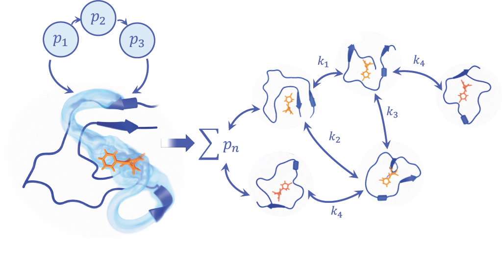
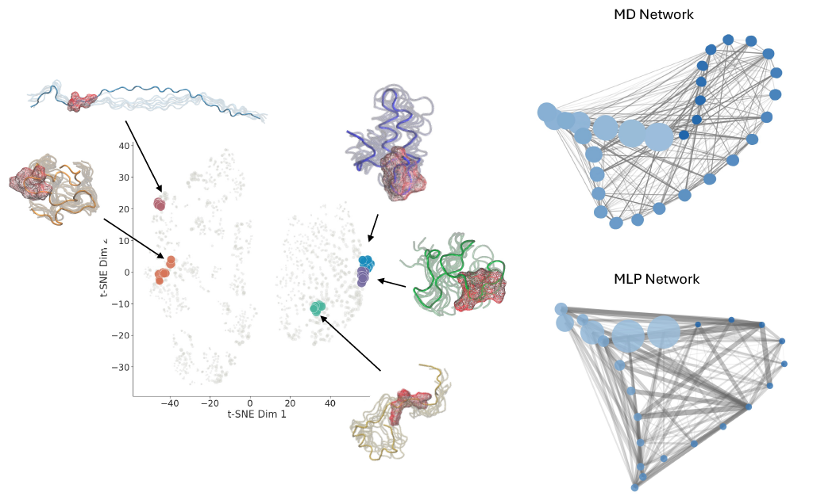

# Sequence-Based Predictions of Small Molecule Binding Paths

Code and processed data for:

> Adelie Louet, Hilbert Lam, Gerhard Hummer, Michele Vendruscolo. *Sequence-Based Predictions of Small Molecule Binding Paths.*

Intrinsically disordered proteins (IDPs) don't have a stable pocket, so small molecules tend to bind them through a "dynamic shuttling" mechanism: the ligand diffuses over the surface and makes many weak, transient contacts instead of sitting in one site. We describe this as a binding path, a network of residue triplet states, each with an equilibrium population (p_eq) obtained from a Markov State Model built on MD.

  <p align="center">
    
  </p>

This repo contains an MLP that predicts p_eq for residue triplets **from sequence alone** (ESM-2 embeddings + Boltz-2 predicted CA distances), and the pipeline that clusters the top triplets into pockets along the binding path and connects them into a network. No reference structure or trajectory frame is needed, so predictions are frame independent.

## How it works

1. **Embeddings**: each residue gets a 480-dim embedding from frozen ESM-2 (`esm2_t12_35M_UR50D`).
2. **Geometry**: CA-CA distances come from Boltz-2. Each triplet (i, j, k) gets 10 features: i/L, j/L, k/L, d_ij, d_jk, d_ik, min, max, mean distance and compactness (min/max).
3. **Model**: the 3 embeddings + 10 features (480*3 + 10) go through an MLP (512 → 128 → 32 → 1, LayerNorm, LeakyReLU, dropout) that predicts a normalised log(p_eq). It was trained on ~15,000 mixed-solvent probe MD simulations.
4. **Inference**: candidate triplets are built from the 40 nearest spatial neighbours of each residue, then scored and ranked.
5. **Pockets**: top triplets are hierarchically clustered on spatial distance, chemistry (Kyte-Doolittle hydrophobicity, H-bond donors/acceptors, charge) and score similarity. A knee cutoff on the summed cluster score keeps the clusters that make up the binding path.
6. **Network**: triplets sharing at least one residue are linked, weighted by the harmonic mean of their predicted populations, giving a pocket-level binding path graph.

  <p align="center">
    
  </p>
## Repository layout

```
model/
  train_esm_2_negative_data.py        train the triplet MLP
  inference_pocket.py                 predict + cluster pockets for one protein
  predicting_transitions/
    inference_building_macrostate_graph_harmonic.py   build the pocket network (harmonic edge weights)
  generate_boltz_distances_probes.py  Boltz-2 CA distance matrices for the training proteins
  generate_jacobian_features_zhang.py categorical Jacobian couplings (ablation, Zhang et al.)
  weights/
    best_model_change_ranking.pt      trained model (best val Spearman)
    model_change_ranking.pt           model at the last epoch

analysis/
  disordered_proteins/                IDP test set: predictions vs MD (AUC, enrichment factor)
  ordered_proteins/                   recovery of literature binding pockets in 10 ordered proteins
  comparing_to_md_ground_truth/       MSM pruning/clustering of the MD, MD vs MLP network comparison
  comparing_softwares/                benchmark vs fpocket, P2Rank, PocketMiner, CryptoSite, ScanNet
  ablations/                          CA distance source ablation, graph edge rule ablation
```

## Data

**Disordered proteins**: `analysis/disordered_proteins/<protein>/<ZINC id>/`. Ten IDPs (Aβ42, α-CGRP, FUS, HTT, p53 C-term, p53 N-term, PACAP-27, prion, tau, TDP-43), each simulated with several ZINC20 ligands.

- `sequence.fasta`: protein sequence
- `ca_dist_matrix_boltz.pkl`: Boltz-2 CA distance matrix (dict, key `'matrix'`)
- `p_eq_keys.pckl`: MSM equilibrium population per residue triplet (MD ground truth)

**Ordered proteins**: `analysis/ordered_proteins/<protein>/`. Acetylcholinesterase, BRD4 BD1, CYP3A4, DC-SIGN, HIV-1 protease, IL-2, influenza neuraminidase, KRAS G12C, SH3 domain, TEM-1 β-lactamase, trypsin.

- `sequence.fasta`
- `ca_dist_matrix_boltz.pkl`

Raw trajectories and the training simulations are too large for GitHub and are not included here.

## Requirements

Python 3 with:

```
torch
transformers
numpy scipy pandas scikit-learn
matplotlib seaborn
networkx mdtraj
wandb          # training logs only
```

Boltz-2 is only needed to make new distance matrices (`generate_boltz_distances_probes.py`).

## Usage

Predict pockets for a protein: set `seq`, `ca_dist_file` and `WEIGHTS` at the top of `model/inference_pocket.py` (use `model/weights/best_model_change_ranking.pt`), then

```
python model/inference_pocket.py
```

The ranked triplets, a cluster table (`figures/top_triplet_clusters.csv`) and plots are written to `figures/`.

Train the model: point `base` in `model/train_esm_2_negative_data.py` at a folder with one subfolder per protein, each containing `p_eq_keys.pkl`, `sequence.fasta` and `ca_dist_matrix_boltz.pkl`, then

```
python model/train_esm_2_negative_data.py
```

Paths in the scripts are currently set to our cluster (`/ptmp/...`) and need changing to run elsewhere.

## Citation

If you use this code, please cite:

```
Louet A, Lam H, Hummer G, Vendruscolo M.
Sequence-Based Predictions of Small Molecule Binding Paths.
```
